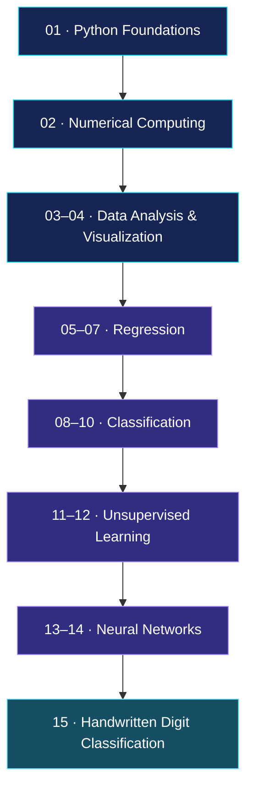
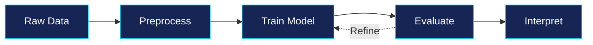

<div align="center">


**LEARN THE THEORY · IMPLEMENT THE LOGIC · EVALUATE THE RESULTS**

[Overview](#01--overview) · [Roadmap](#02--learning-roadmap) · [Lab Index](#04--lab-index) · [Setup](#07--getting-started)

</div>

---

## 01 / Overview

Machine learning is more than training a model. It is the process of transforming raw data into meaningful insights, measurable predictions and intelligent decisions.

This repository documents my practical journey through **CS-3105 — Machine Learning Lab**, from Python fundamentals to handwritten digit classification. It is designed as a growing collection of reproducible experiments, documented solutions, visualizations and model evaluations.

| Academic profile | Details |
| :--- | :--- |
| Student | **Saqlain Mushtaq** |
| Roll number | **2024-SE-35** |
| Degree | BS Software Engineering |
| University | The University of Azad Jammu & Kashmir, Muzaffarabad |
| Course | CS-3105 — Machine Learning Lab |
| Instructor | Engr. Muhammad Awais |

## 02 / Learning Roadmap



## 03 / Course Learning Outcomes

| CLO | Learning outcome | Cognitive level | PLO | Labs |
| :---: | :--- | :--- | :--- | :---: |
| 05 | Use Python programming and tools for data handling and basic operations | C-3 · Apply | PLO 5 · Modern Tool Usage | 01–02 |
| 06 | Analyze real-world datasets using data manipulation and visualization techniques | C-4 · Analyze | PLO 2 · Problem Analysis | 03–04 |
| 07 | Apply machine learning algorithms and assess performance using appropriate evaluation metrics | C-3 · Apply | PLO 4 · Investigation | 05–15 |

## 04 / Lab Index

<div align="center">


*Update the progress badge and status column as labs are completed.*

</div>

| Lab | Experiment / Topic | Domain | CLO | Status |
| :---: | :--- | :--- | :---: | :---: |
| `01` | Introduction to Python Programming | Foundations | 05 | ✅ |
| `02` | NumPy — Arrays and Vectorized Mathematics | Foundations | 05 | ✅ |
| `03` | Pandas — Loading, Cleaning and Exploring Data | Data Analysis | 06 | ✅ |
| `04` | Matplotlib and Seaborn — Data Visualization | Data Analysis | 06 | 🟡 |
| `05` | Simple Linear Regression | Supervised ML | 07 | ✅ |
| `06` | Multiple Linear Regression | Supervised ML | 07 | ⬜ |
| `07` | Logistic Regression | Supervised ML | 07 | ⬜ |
| `08` | K-Nearest Neighbors (KNN) | Supervised ML | 07 | ⬜ |
| `09` | ID3 Decision Tree | Supervised ML | 07 | ⬜ |
| `10` | Naive Bayes | Supervised ML | 07 | ⬜ |
| `11` | K-Means Clustering | Unsupervised ML | 07 | ⬜ |
| `12` | DBSCAN Clustering | Unsupervised ML | 07 | ⬜ |
| `13` | Single-Layer Perceptron | Neural Networks | 07 | ⬜ |
| `14` | Multi-Layer Perceptron | Neural Networks | 07 | ⬜ |
| `15` | Open-Ended Lab — Handwritten Digit Classification | Applied ML | 07 | ⬜ |

**Status key:** ✅ Completed · 🟡 In progress · ⬜ Not updated

## 05 / Technology Stack

<div align="center">


</div>

| Layer | Tools | Labs |
| :--- | :--- | :--- |
| Programming | Python 3.9+ (compatible version required) | 01–15 |
| Numerical computation | NumPy | 02 onward |
| Data manipulation | Pandas | 03 onward |
| Visualization | Matplotlib, Seaborn | 04 onward |
| Modeling and evaluation | scikit-learn, custom implementations | 05–15 |
| Development environment | Jupyter Notebook, Google Colab, VS Code | All |

## 06 / Repository Architecture

Suggested structure as experiments are added:

```text
Machine-Learning-Lab/
├── Lab-01-Python-Basics/
│   ├── Lab01_RollNo_SaqlainMushtaq.ipynb
│   ├── Lab01_Report.html
│   └── README.md
├── Lab-02-NumPy/
├── Lab-03-Pandas/
├── Lab-04-Data-Visualization/
├── ...
├── Lab-15-Handwritten-Digits/
├── requirements.txt
└── README.md
```

Each lab is intended to be a self-contained experiment with an objective, implementation, results and interpretation.

## 07 / Getting Started

### Option A — Google Colab

[](https://colab.research.google.com/)

1. Download the required `.ipynb` file from the repository.
2. Open Google Colab and upload the notebook.
3. Select **Runtime → Run all** (restart the runtime first for a clean execution).

### Option B — Local environment (Windows PowerShell)

Clone the repository using its actual HTTPS URL and enter its directory. Then run:

```powershell
py -m venv .venv
.\.venv\Scripts\python.exe -m pip install --upgrade pip
.\.venv\Scripts\python.exe -m pip install notebook numpy pandas matplotlib seaborn scikit-learn
.\.venv\Scripts\python.exe -m notebook
```

Open the desired notebook and restart the kernel before running all cells. Use a Python version compatible with the installed libraries.

## 08 / Experimental Workflow



For applicable modeling labs, split data before fitting preprocessing steps to prevent data leakage. Use suitable evaluation metrics such as MAE, RMSE and R² for regression, precision, recall and F1-score for classification, and silhouette score where appropriate for clustering.

## 09 / Documentation Standards

- One organized notebook per lab, following `LabNN_RollNo_Name.ipynb`.
- Markdown explanations covering the task, approach and expected output.
- Readable code, meaningful variable names and clearly labeled results.
- Relevant visualizations and interpretation of experimental findings.
- Reproducible runs with fixed random seeds where applicable.
- Academic integrity, with external references and assistance acknowledged as required.

---

<div align="center">

### Saqlain Mushtaq

**Software Engineering Student · Machine Learning Explorer**

*The University of Azad Jammu & Kashmir, Muzaffarabad*

[](https://github.com/SaqlainMushtaq590))

*Every experiment is a step toward understanding intelligence.*


</div>
